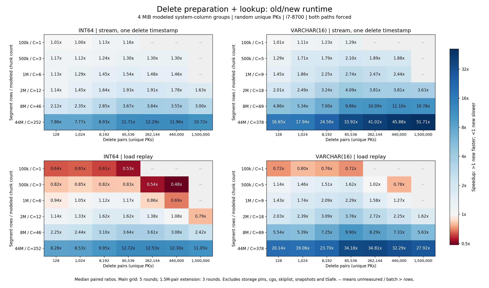
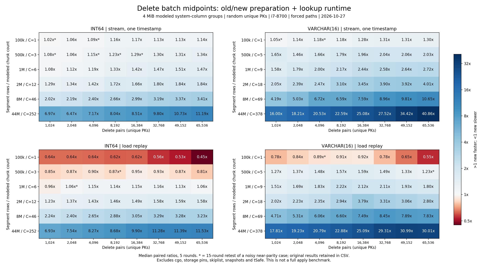

# Segcore sealed 删除查找优化：分析、历次测试与启用策略

评审摘要见 [Delete 优化测试与结论（2026-10-30）](segcore-delete-test-conclusions-20261030.zh.md)，包含主要收益、退化反例、候选门槛及验证边界。

整理日期：2026-10-28。范围：当前工作区 PR 中 sealed 段的删除排序和批量 PK 查找；同时归档此前讨论引用的原型结果与本地测试。

**结论：新模式主要适合 PK 有序、实际 PK chunk 较多的 sealed 段。重复 PK 不是必要条件。流式删除原本就排序，比原本不排序的加载回放更容易获益。仅用 `pairs >= 1024` 不能可靠排除退化。**

本报告建议的初始策略是：流式要求 `C >= 16 && B >= 1024`，回放要求 `C >= 32 && B >= 1024`，其中 C 是实际 PK 列 chunk 数，B 是本批实际参与处理的删除 pair 数。它是基于本机组件测试的保守候选规则，不是所有硬件、数据布局和批量下的性能保证。**该策略尚未写入生产代码；当前代码仍使用 1024 门槛。**

原始数据、元数据和图表保存在相邻的 [归档目录](segcore-delete-20261028/README.md)，不依赖 `/tmp` 文件继续存在。本次只整理和校验已有结果，没有重新运行 Milvus A/B 或性能矩阵。

## 1. 优化改变了什么

涉及的主要入口和实现：

- [`ChunkedSegmentSealedImpl::Delete / LoadDeletedRecord / search_batch_pks`](../../internal/core/src/segcore/ChunkedSegmentSealedImpl.cpp)。
- [`DeletedRecord::StreamPush / LoadPush / InternalPush`](../../internal/core/src/segcore/DeletedRecord.h)。
- [`GallopingLowerBound`](../../internal/core/src/common/GallopingSearch.h)。

有序 PK 列的原查找路径是：遍历每个 chunk，对每个删除 pair 独立二分，再遍历该 PK 对应的物理行版本，按插入时间戳与删除时间戳的关系产生回调。它不是只在“命中的那个 chunk”里做一次二分；无关 chunk 也承担查找成本。

当前 PR 的新路径先让输入 PK 有序，再按 chunk 遍历，使用只向前移动的输入游标和 chunk 内游标，通过 galloping（指数探测后局部二分）定位。相同 PK 的一组 pair 共享一次定位，但保留各个删除事件及其时间戳。跨 chunk 的相同 PK 仍需逐个 chunk 检查，不能在第一个 chunk 命中后把该 PK 消费掉。

这里的“归并”指利用双方有序性推进游标，**并非必须线性扫描整个段的所有行**。普通逐键取数接口、growing 段和上层删除 API 不是本次查找优化的对象。

| 入口 | 原路径的整理方式 | 新路径的整理方式 |
|---|---|---|
| 流式 `Delete` | `(TS, PK)` 排序 | `(PK, TS)` 排序；同 PK 内保持 TS 升序 |
| 回放 `LoadDeletedRecord` | 保持输入顺序 | `(PK, 原始下标)` 排序；同 PK 内保持原事件顺序 |

当前 PR 用下标排序和置换移动重排，避免原型中复制整批 `(PK, TS)` 元组的方式。`DeletedRecord` 从整批求最小、最大时间戳，快照门控使用真正的最小时间戳，不能在按 PK 排序后继续把 `timestamps[0]` 当成最小值。

工作区还包含导入段复用 `search_batch_pks`、读取插入时间戳时复用单个已 pin 时间戳 chunk 的改动。组件测试使用内存时间戳数组，且两侧共用该模型，**没有测出这些改动相对原始 master 的独立收益**；完整 PR 的收益不能只用下文的模式切换比值表示。

### 1.1 pair 数不等于实际删除行数

本报告 B 表示输入 `(PK, delete_ts)` 事件数量。它不是去重后的 PK 数，也不必等于受影响的行数：同 PK 可出现多个删除事件，一个 PK 可能对应多个插入版本，也可能不存在或因时间戳过滤而不产生删除回调。后续 `uniform_unique` 测试只为控制变量而使用互不重复、存在于段内的 PK，不代表生产数据总是这样。

### 1.2 新增或变化的成本

- 流式原本就排序，比较的是两种排序顺序及查找方式的总成本，而不是“无排序”与“有排序”。
- 回放原本不排序，新增时间戳副本、下标数组、排序和置换重排，批量大时可能主导耗时。
- 新查找还需要有序检查、同 PK 分组、chunk 边界判断与指数探测。稀疏且相距较远的 PK，在少 chunk 场景下可能比直接二分做更多比较。
- 排序临时内存随批量增长。不能把原型的“每 pair 约 48 字节”直接当成当前实现的精确开销；字符串长度、容器布局和实现不同。本地组件测试没有验证完整进程 RSS。

## 2. 正确性与并发：分析范围

按 PK 排序本身并不破坏时间戳语义，关键是不能改变同一物理行应看到的有效删除事件。流式保留同 PK 的 TS 升序；回放保留同 PK 的原事件顺序，因为 `LoadPush`/删除 mask 的“第一个有效删除”语义不能被任意改写。不同 PK 组之间的处理顺序可以变化，但不能因此声称整个批次的写入具有原子性。

原先 `(TS, PK)` 排序也不单独提供批次原子性；旧查找本来就有 chunk 外层循环。`InternalPush` 会逐条写入删除结构，`deltaMut` 是段内删除写者间的串行化，不是查询与整个删除批次互斥的锁。

普通流式消费路径中，[delete_node](../../internal/querynodev2/pipeline/delete_node.go) 在 `ProcessDeleteBatches` 返回后才推进 tSafe；[LocalSegment](../../internal/querynodev2/segments/segment.go) 使用 `deltaMut` 串行化 Delete/LoadDeltaData。在“新删除时间戳高于已有 tSafe、查询遵循相应可见性边界”的前提下，早期查询不会因处理中批次改变旧快照结果，等待新可见性边界的查询应在处理完成后继续。分析参考 [Streaming 系统总览](../agent_guides/streaming-system/streaming-system.md)、[TimeTick 与事务](../agent_guides/streaming-system/wal/timetick_and_txn.md) 及调用处源码。

**不能据此宣称所有并发路径已验证一致。** 迟到旧删除、回放与发布、特殊查询时间戳、故障重试和所有存储布局没有通过本次性能测试全面覆盖。组件测试的回调数量和哈希检查也不是完整 MVCC、bitmap、快照或并发可见性测试。

当前工作区包含 [ChunkedDeleteTest](../../internal/core/src/segcore/ChunkedDeleteTest.cpp) 和 [DeletedRecordTest](../../internal/core/src/segcore/DeletedRecordTest.cpp) 的相关用例修改，涵盖跨 chunk 重复 PK、版本与快照门控等方向；本报告不将这些用例的存在当作本轮已执行完整测试套件的证据。

## 3. 三种测试口径必须分开

| 结果来源 | 基线 → 新路径 | 计时范围 | 能说明什么 |
|---|---|---|---|
| 用户提供的原型报告 | master `179225cd09` → 原型 `b987f14b6b` | 运行 Milvus 的实际 apply、load、tSafe 停滞 | 报告中指定机器与工作负载的实际效果；本次未复现 |
| 最早 lookup-only 小测试 | 独立二分 → 提取的有序查找内核 | 输入已排序，只测查找 | 算法方向；不能据此决定含排序的启用门槛 |
| 后续 threshold/layout/size/midpoint 测试 | 当前 PR 内强制二分 → 强制新模式 | 排序整理＋查找 | 当前实现中切换查找模式的组件收益 |

后续测试的二分侧已经使用当前 PR 的下标排序、置换重排；**不是 master 的完整旧实现**。两个路径都强制执行，不受生产代码 1024 门槛控制，因此也能测到门槛以下的行为。

### 3.1 后续组件测试计时边界

计时开始在时间戳复制和重排之前，结束在查找完成之后。包含下标数组分配、排序比较、PK/TS 移动重排、有序检查、定位及回调计算；流式二分侧也包含其自身排序成本。

不包含 IDs 解析（以计时外 PK 副本建模）、公共 PK 存在性过滤、cgo、真实存储 pin/I/O、跳表插入、bitmap/快照发布、Go 层 L0 物化和 tSafe。VARCHAR 使用连续字符区加 uint32 offset 模拟，不包含生产 StringChunk 的全部包装层。

每次 warmup 和计时调用都对回调数量及交换律哈希与独立 oracle 校验。它检查匹配结果，不提供回调顺序、完整 MVCC 或并发正确性的证明。

### 3.2 环境与统计

- 本机：Intel Core i7-8700，6 核 12 线程，12 MiB L3，约 32 GB 内存；x86_64，C++ 11.4，`-O3 -DNDEBUG -std=c++20`。
- 后续 layout/size/midpoint 固定 CPU 2；早期运行的 CPU 以对应 metadata 为准，最初 sweep 记录 CPU 0。没有把不同 CPU/轮次混成一次连续采样。
- old/new 交替顺序、轮换独立批次，不主动清空 cache。较小批次每轮内部重复若干次，所以 CSV `samples` 不一定等于外层轮数。
- `speedup` 是每轮 old/new 比值的中位数，>1 表示新模式更快。`round_min_speedup`/`round_max_speedup` 是各轮极值，不是置信区间。
- prepare、lookup、total 分别取中位数，不能要求“阶段中位数之和恰好等于 total 中位数”，也不能要求两个 total 中位数相除完全等于 `speedup`。
- 原始 metadata 保存参数、编译器、CPU、源文件与提取内核哈希。size/midpoint 的源文件 SHA256 为 `1cc52aaeac3c7ebf992b45085ec138debbee97a7520751efe14f279102a57ff7`，内核为 `34ffe043463300266fb63c248e0949e47ef50bab7e177f5a8df9bfb3b090e4f4`，benchmark 为 `19f7e0242f6bdee50475168d4d4b910b71c378dd5c720c5e2853b607449d44d8`。

## 4. 一个 chunk 能装多少 PK

2026-10-28 逐层核查补充：[storage → row group → cell → PK chunk 的实际切分与计算](segcore-delete-20261028/storage-cell-chunk.md)。其中给出 V1/V2/V3 的不同公式、V3 跨文件合并与字段投影、文件尾组和真实边界的影响。下面的 1/4 MiB 表只描述测试模型，不是加载端精确计算规则。

段行数本身不能决定 chunk 数。实际边界由文件、row group、列组投影、Cell 合并策略等决定；磁盘压缩大小也不等于 PK 在内存中的大小。参考 [当前底层读取结构](../design-docs/design_docs/20260928-segcore-current-read-paths.zh.md) 与其中链接的 Column/Translator 实现。

- Storage V1 单字段路径，一个 binlog 文件对应一个缓存 chunk/cell，可能是少量大 chunk。
- V2 列组路径不跨文件合并；stats skip 配置可强制一 row group 对应一 cell。
- Manifest 路径按投影大小、row group 和目标 cell 大小组合，至少保留一个 row group，实际 chunk 可以大于目标。

本次现实布局近似模型使用系统列组：`row_id(8) + timestamp(8) + PK`。int64 为 24 B/行，16 字节 VARCHAR 加 offset 后约 36 B/行。若只投影 PK，则宽度又不同。

| 估算布局 | 每行建模字节 | 1 MiB 对应行数（约） | 4 MiB 对应行数（约） | 44M 行时 4 MiB / 1 MiB chunk 数 |
|---|---:|---:|---:|---:|
| int64 系统列组 | 24 | 43,690 | 174,762 | 252 / 1008 |
| VARCHAR16 系统列组 | 36 | 29,127 | 116,508 | 378 / 1511 |
| int64 只投影 PK | 8 | 131,072 | 524,288 | 84 / 336 |

测试使用 `C = ceil(N × modeled_row_bytes / target_bytes)`，再将 N 行均匀分成 C 个 chunk。**这是贴近可能布局的合成模型，不是读取真实加载段的 metadata。** 初期固定 1/8 个 chunk 的结果仍适用于少量大 chunk 对照，但不能代表所有 V2/V3 段。

落地策略中的 C 应来自当前 PK 列的 `num_chunks()`，必要时配合 `chunk_row_nums()` 检查分布。它不是向量字段 chunk 数，不是本批命中的 chunk 数，也不应由上述估算公式代替。严重不均匀布局是当前规则尚需验证的边界。

## 5. 原型报告的实际 Milvus A/B（用户提供，未复现）

报告日期 2026-10-15，Ryzen 9 7945HX，44M 行单段，关闭自动 compaction；基线与原型各自 wipe 后重新导入。以下保留原报告数字，不能与本机组件测试直接拼接。

| 场景 | int64：基线 → 原型 | VARCHAR：基线 → 原型 |
|---|---:|---:|
| 440k pairs，一次 apply | 5.4 s → 0.2 s，27× | 22.5 s → 0.3 s，75× |
| 150 万 pairs，一次 apply | 18.2 s → 0.6 s，约 30× | 76.6 s → 1.1 s，约 70× |
| 共 440 万 pairs，44 次各 100k：apply / tSafe 停滞 | 51.9 / 43.6 s → 1.5 / 0.25 s | 222.6 / 209.8 s → 2.6 / 0.08 s |
| load 回放 634 万删除记录 | 92.9 s → 9.9 s，约 9.4× | 380.9 s → 10.9 s，约 35× |

原报告另有 128 维向量表、int64、2M 行一段，删 400k：0.32 s → 0.12 s，约 2.7×；RSS 峰值 3982 MB 与 3970 MB。报告称完成 count、已删区间、边界 PK 和基线重新加载原型删除记录的检查；报告的脚本及原始日志未提供到本归档，因此仅作为外部提供的结果记录。

该原型的 key-major 跨 chunk 重复 PK 处理不能直接沿用；当前 PR 使用 chunk-major 分组遍历。回放排序也改为保留同 PK 原事件顺序。因此上述倍数既不是当前 PR 的复测结果，也不是对原型所有边界正确性的背书。

## 6. 本地历次测试与结论修正

| 阶段 | 记录数 | 主要覆盖 | 结果用途 |
|---|---:|---|---|
| lookup-only | 40 | 2M/44M；1/8 chunks；随机/连续；1～100k pairs | 不含排序，仅作早期方向观察 |
| 初期 threshold 主扫描 | 1260 | 32,768/2M/44M；1/8 chunks；两类型、五种分布、三种时间戳模式 | 说明少 chunk 时 1024 并非通用收益线 |
| threshold 边界＋大稀疏 | 320＋20 | 1023/1024/1025 等边界；44M 单 chunk 至 524,288 pairs | 与主扫描合并为 1600 条，不能重复累计 |
| 初次布局纠偏 | 24＋8 | PK-only 84/336 chunks；系统列组 252/1008 chunks | 验证实际布局对结论的重要性 |
| 扩展 layout | 2786 | 1～1511 chunks；五种分布；三种模式；小批量至 65,536 | 形成初步 chunk 门槛，再由百万级回放测试修正 |
| 不同段行数／批量矩阵 | 192 | 4 MiB 主矩阵 136＋1 MiB 32＋150 万 pairs 12＋门槛对照 12 | 暴露中等 chunk 回放的大批量退化 |
| 1024～65,536 中间点加密 | 192，另复测其中 12 条 | 1024/2048/4096/8192/16384/32768/49152/65536 | 检查趋势与噪声，没有发现统一批量拐点 |

另归档初期 smoke 120 条及 size smoke 24 条，不把它们当成额外独立性能结论。所有计数都是配置记录数，不是生产查询数量。

### 6.1 初期查找与 threshold 测试

最早只测查找的 44M、8 chunks、连续 100k PK，曾得到 26.86×；同样 44M、1 chunk、随机 100k PK 仅 0.98×。**这组倍数没有计算排序成本。** 完整 40 行在 [lookup-only 日志](segcore-delete-20261028/lookup-only/delete-opt-lookup-bench.log)，对应源码也已归档。

之后改为计入整理开销。在 1600 条初期记录中，筛选 `B >= 1024`：回放 422 条中有 183 条中位数慢于二分；同 TS 流式 422 条中有 68 条较慢；混合 TS 流式 300 条中有 25 条较慢。它们局限于 1/8 chunks，不能外推为“优化没有用”。例如 44M、单 chunk、1024 个不存在的 int64 PK，同 TS 流式比值 0.7497；新路径比较次数及整理成本不能靠少量 chunk 的查找节省抵消。

改用 PK-only 84/336 chunks 后的 24 条布局测试均有收益，最低比值 3.1515；系统列组 252/1008 chunks 的 8 条最低 7.8358。由此确认，应优先核对真实 chunk 布局，不能单看段行数。

### 6.2 扩展 layout 测试与被后续推翻的门槛

2786 条 layout 记录覆盖 uniform、dense、repeated、repeated_half、miss；流式同 TS、流式混合 TS、回放；不同种子和 7 轮重复。`uniform` 是有放回采样，后续 `uniform_unique` 才严格不重复。

这轮曾提出：`C < 16` 回退，`16 <= C < 32` 要求 `B >= 1024`，`C >= 32` 要求 `B >= 128`。当时选中的 846 条中未观察到退化。但它缺少百万级回放，**后来 2M 行、16 chunks、150 万 pairs 回放的 0.9508× 结果推翻了这个统一门槛**。历史 [analysis JSON](segcore-delete-20261028/layouts/delete-layout-analysis.json) 保留原样，其中的旧候选结论不能当作最终建议。

### 6.3 不同段行数、删除 pair 数的完整矩阵

数据为随机不重复、存在的 PK；`B > N` 的组合跳过，不伪造重复 PK 来凑足批量。4 MiB 系统列组模型，主矩阵 5 轮，百万级扩展 3 轮。下面四张表是**第一轮行数／批量矩阵**，不是把后续加密测试的端点混进来；数值为加速比。

<!-- SIZE_TABLES -->

**int64，同 TS 流式；加速比 > 1 表示新模式更快。**

| 段行数 | chunk 数 | 128 pairs | 1,024 pairs | 8,192 pairs | 65,536 pairs | 262,144 pairs | 440,000 pairs | 1,500,000 pairs |
|---:|---:|---:|---:|---:|---:|---:|---:|---:|
| 100,000 | 1 | 1.01 | 1.00 | 1.13 | 1.16 | — | — | — |
| 500,000 | 3 | 1.17 | 1.12 | 1.24 | 1.30 | 1.30 | 1.30 | — |
| 1,000,000 | 6 | 1.13 | 1.29 | 1.45 | 1.54 | 1.48 | 1.46 | — |
| 2,000,000 | 12 | 1.14 | 1.45 | 1.64 | 1.93 | 1.91 | 1.78 | 1.63 |
| 8,000,000 | 46 | 2.12 | 2.35 | 2.85 | 3.67 | 3.84 | 3.55 | 3.00 |
| 44,000,000 | 252 | 7.86 | 7.77 | 8.93 | 11.71 | 12.29 | 11.96 | 10.72 |

**int64，回放；加速比 > 1 表示新模式更快。**

| 段行数 | chunk 数 | 128 pairs | 1,024 pairs | 8,192 pairs | 65,536 pairs | 262,144 pairs | 440,000 pairs | 1,500,000 pairs |
|---:|---:|---:|---:|---:|---:|---:|---:|---:|
| 100,000 | 1 | 0.64 | 0.65 | 0.61 | 0.53 | — | — | — |
| 500,000 | 3 | 0.82 | 0.85 | 0.82 | 0.83 | 0.54 | 0.48 | — |
| 1,000,000 | 6 | 0.94 | 1.05 | 1.12 | 1.17 | 0.86 | 0.69 | — |
| 2,000,000 | 12 | 1.14 | 1.33 | 1.62 | 1.62 | 1.38 | 1.08 | 0.79 |
| 8,000,000 | 46 | 2.25 | 2.44 | 3.10 | 3.64 | 3.61 | 3.08 | 2.42 |
| 44,000,000 | 252 | 8.28 | 8.53 | 9.95 | 12.72 | 12.53 | 12.30 | 11.05 |

**varchar16，同 TS 流式；加速比 > 1 表示新模式更快。**

| 段行数 | chunk 数 | 128 pairs | 1,024 pairs | 8,192 pairs | 65,536 pairs | 262,144 pairs | 440,000 pairs | 1,500,000 pairs |
|---:|---:|---:|---:|---:|---:|---:|---:|---:|
| 100,000 | 1 | 1.01 | 1.11 | 1.23 | 1.29 | — | — | — |
| 500,000 | 5 | 1.29 | 1.71 | 1.79 | 2.10 | 1.89 | 1.88 | — |
| 1,000,000 | 9 | 1.45 | 1.86 | 2.25 | 2.74 | 2.47 | 2.44 | — |
| 2,000,000 | 18 | 2.01 | 2.49 | 3.24 | 4.09 | 3.81 | 3.81 | 3.63 |
| 8,000,000 | 69 | 4.86 | 5.34 | 7.00 | 9.86 | 10.09 | 11.10 | 10.78 |
| 44,000,000 | 378 | 16.65 | 17.94 | 24.56 | 33.92 | 41.02 | 45.88 | 51.71 |

**varchar16，回放；加速比 > 1 表示新模式更快。**

| 段行数 | chunk 数 | 128 pairs | 1,024 pairs | 8,192 pairs | 65,536 pairs | 262,144 pairs | 440,000 pairs | 1,500,000 pairs |
|---:|---:|---:|---:|---:|---:|---:|---:|---:|
| 100,000 | 1 | 0.72 | 0.80 | 0.76 | 0.72 | — | — | — |
| 500,000 | 5 | 1.14 | 1.46 | 1.51 | 1.62 | 1.02 | 0.78 | — |
| 1,000,000 | 9 | 1.43 | 1.74 | 2.09 | 2.29 | 1.58 | 1.27 | — |
| 2,000,000 | 18 | 2.03 | 2.39 | 3.09 | 3.76 | 2.72 | 2.25 | 1.62 |
| 8,000,000 | 69 | 5.54 | 5.39 | 7.25 | 9.90 | 8.29 | 7.33 | 5.63 |
| 44,000,000 | 378 | 20.14 | 19.06 | 23.70 | 34.18 | 34.81 | 32.29 | 27.92 |

<!-- END SIZE_TABLES -->

完整阶段拆分与绝对耗时见 [192 条汇总 CSV](segcore-delete-20261028/sizes/delete-size-results.csv)。



### 6.4 大批量回放的反例与排序成本

以下均为 int64、随机不重复 PK，时间为毫秒，包含整理＋查找。

<!-- REGRESSION_TABLE -->

| 段行数 | chunks | pairs | 二分总耗时 ms | 新模式总耗时 ms | 加速比 |
|---:|---:|---:|---:|---:|---:|
| 2,000,000 | 12 | 65,536 | 25.484 | 15.696 | 1.6201 |
| 2,000,000 | 12 | 440,000 | 163.940 | 150.159 | 1.0844 |
| 2,000,000 | 12 | 1,500,000 | 533.193 | 666.017 | 0.7946 |
| 2,000,000 | 16 | 1,500,000 | 629.243 | 660.924 | 0.9508 |
| 2,000,000 | 32 | 1,500,000 | 1044.221 | 664.089 | 1.5686 |
| 500,000 | 3 | 440,000 | 69.458 | 142.799 | 0.4847 |

<!-- END REGRESSION_TABLE -->

2M 行、12 chunks、150 万 pairs 时，新路径约 640 ms 用于整理，查找约 26 ms。相比之下流式原本就支付排序成本，不存在同样的“从零新增整批排序”差额。故不能假设批量越大收益越高，也不能只给回放设置一个最小 B 就认定所有更大批次都安全。

同为 44M 行、65,536 pairs、同 TS 流式，int64 的 4 MiB / 1 MiB 模型分别为 11.7075× / 39.2585×；VARCHAR16 分别为 33.9183× / 116.3891×。这些差异同时反映了 chunk 数改变，不能全部解释为缓存或 PK 类型的影响。

### 6.5 1024～65,536 pairs 加密测试

增加 2048、4096、16384、32768、49152，并在同轮重测 1024、8192、65536。6 种 N × 2 种 PK × 2 路径 × 8 种 B = 192 条，5 轮，seed 880301，CPU 2，4 MiB 模型，随机不重复 PK。

复测条件预先写入计划：`0.85 <= 中位数比值 <= 1.3` 且各轮比值跨越 1。满足的 12 条全部追加 15 轮，表中用复测值替换，星号标注；原值保存在 `original_speedup`，原始 `matrix.csv` 未覆盖。例如 500k int64 流式、4096 pairs 的首轮 0.9392×、范围 0.8022～1.4188，复测为 1.1468×、范围 1.1059～1.1946，不应将首次低值解释为确定的性能断崖。

<!-- MIDPOINT_TABLES -->

**int64，同 TS 流式；加速比 > 1 表示新模式更快。**

| 段行数 | chunk 数 | 1,024 pairs | 2,048 pairs | 4,096 pairs | 8,192 pairs | 16,384 pairs | 32,768 pairs | 49,152 pairs | 65,536 pairs |
|---:|---:|---:|---:|---:|---:|---:|---:|---:|---:|
| 100,000 | 1 | 1.02* | 1.06 | 1.09* | 1.16 | 1.17 | 1.13 | 1.13 | 1.14 |
| 500,000 | 3 | 1.08* | 1.06 | 1.15* | 1.23* | 1.29* | 1.30 | 1.31 | 1.34 |
| 1,000,000 | 6 | 1.08 | 1.12 | 1.19 | 1.33 | 1.42 | 1.47 | 1.51 | 1.47 |
| 2,000,000 | 12 | 1.29 | 1.34 | 1.42 | 1.72 | 1.66 | 1.80 | 1.84 | 1.84 |
| 8,000,000 | 46 | 2.02 | 2.19 | 2.40 | 2.66 | 2.99 | 3.19 | 3.37 | 3.41 |
| 44,000,000 | 252 | 6.97 | 6.47 | 7.17 | 8.04 | 8.51 | 9.80 | 10.73 | 11.19 |

**int64，回放；加速比 > 1 表示新模式更快。**

| 段行数 | chunk 数 | 1,024 pairs | 2,048 pairs | 4,096 pairs | 8,192 pairs | 16,384 pairs | 32,768 pairs | 49,152 pairs | 65,536 pairs |
|---:|---:|---:|---:|---:|---:|---:|---:|---:|---:|
| 100,000 | 1 | 0.64 | 0.64 | 0.64 | 0.62 | 0.62 | 0.56 | 0.53 | 0.45 |
| 500,000 | 3 | 0.85 | 0.87 | 0.90 | 0.87* | 0.95 | 0.93 | 0.87 | 0.81 |
| 1,000,000 | 6 | 0.96 | 1.06* | 1.15 | 1.14 | 1.15 | 1.16 | 1.13 | 1.06 |
| 2,000,000 | 12 | 1.23 | 1.37 | 1.43 | 1.46 | 1.49 | 1.58 | 1.59 | 1.58 |
| 8,000,000 | 46 | 2.24 | 2.40 | 2.65 | 2.88 | 3.05 | 3.29 | 3.28 | 3.23 |
| 44,000,000 | 252 | 6.93 | 7.54 | 8.27 | 8.68 | 9.90 | 11.28 | 11.39 | 11.53 |

**varchar16，同 TS 流式；加速比 > 1 表示新模式更快。**

| 段行数 | chunk 数 | 1,024 pairs | 2,048 pairs | 4,096 pairs | 8,192 pairs | 16,384 pairs | 32,768 pairs | 49,152 pairs | 65,536 pairs |
|---:|---:|---:|---:|---:|---:|---:|---:|---:|---:|
| 100,000 | 1 | 1.05* | 1.14 | 1.18* | 1.18 | 1.28 | 1.31 | 1.31 | 1.30 |
| 500,000 | 5 | 1.65 | 1.46 | 1.66 | 1.79 | 1.96 | 2.04 | 2.06 | 2.03 |
| 1,000,000 | 9 | 1.58 | 1.79 | 2.00 | 2.17 | 2.44 | 2.58 | 2.64 | 2.72 |
| 2,000,000 | 18 | 2.05 | 2.39 | 2.47 | 3.10 | 3.45 | 3.90 | 3.92 | 4.01 |
| 8,000,000 | 69 | 4.19 | 5.03 | 6.72 | 6.59 | 7.59 | 8.96 | 9.81 | 10.65 |
| 44,000,000 | 378 | 16.00 | 18.21 | 20.53 | 22.59 | 25.08 | 27.52 | 34.42 | 40.86 |

**varchar16，回放；加速比 > 1 表示新模式更快。**

| 段行数 | chunk 数 | 1,024 pairs | 2,048 pairs | 4,096 pairs | 8,192 pairs | 16,384 pairs | 32,768 pairs | 49,152 pairs | 65,536 pairs |
|---:|---:|---:|---:|---:|---:|---:|---:|---:|---:|
| 100,000 | 1 | 0.78 | 0.84 | 0.89* | 0.91 | 0.92 | 0.78 | 0.65 | 0.55 |
| 500,000 | 5 | 1.27 | 1.37 | 1.48 | 1.57 | 1.59 | 1.49 | 1.33 | 1.23* |
| 1,000,000 | 9 | 1.51 | 1.69 | 1.83 | 2.22 | 2.12 | 2.11 | 1.93 | 1.80 |
| 2,000,000 | 18 | 2.02 | 2.23 | 2.35 | 2.94 | 3.79 | 3.31 | 3.06 | 2.80 |
| 8,000,000 | 69 | 4.71 | 5.31 | 6.06 | 6.60 | 7.49 | 8.45 | 7.89 | 7.83 |
| 44,000,000 | 378 | 17.81 | 19.23 | 20.79 | 22.88 | 25.09 | 29.31 | 30.99 | 30.01 |

<!-- END MIDPOINT_TABLES -->

完整结果见 [加密测试 results.csv](segcore-delete-20261028/delete-size-midpoints-20261027/results.csv)，[复测计划](segcore-delete-20261028/delete-size-midpoints-20261027/retest-plan.json) 和 [校验信息](segcore-delete-20261028/delete-size-midpoints-20261027/validation.json)。



加密结果表明：不存在统一的 4096 或 8192 拐点；多 chunk 已在 1024 获益。2M/12 chunks 的 int64 流式在 32K～64K 附近约 1.8×，继续增加批量没有同幅增长。1M/6 chunks 的 int64 回放从 1024 的约 0.96×，到 4K～32K 约 1.14～1.16×，再回到 64K 的约 1.06×；100k/500k 的 int64 回放在该范围内均慢于二分。

## 7. 建议如何决定是否启用

### 7.1 第一版保守候选规则

共同前提：使用有序的真实 PK 列查找；虚拟 PK 直接映射、未排序段等其他查找路径不因此引入新排序。

| 入口 | 候选规则 | 取舍 |
|---|---|---|
| 流式 Delete | `C >= 16 && B >= 1024` | 放弃少 chunk 的部分收益，保留已测较稳定收益 |
| LoadDeletedRecord 回放 | `C >= 32 && B >= 1024` | 更多 chunk 的节省覆盖新增排序；避开中等 C 的大批量反例 |
| 不满足条件或无法可靠取得布局 | 保持原路径 | 不用估算 chunk 数强行启用 |

重新筛选 layout 2786 条、size 192 条、midpoint 192 条（使用复测替换值），得到：

| 路径 | 满足条件的记录数 | 最低中位数比值 | 最低单轮比值 | 中位数退化记录 |
|---|---:|---:|---:|---:|
| 流式，同 TS 与混合 TS 合计 | 464 | 1.1918 | 1.1422 | 0 |
| 回放 | 175 | 1.5686 | 1.5493 | 0 |

筛选批量范围 1024～150 万；包含跨轮重复配置，并非 639 个独立场景。完整 [筛选记录](segcore-delete-20261028/recommended-gate-selected.csv) 与 [统计](segcore-delete-20261028/recommended-gate-summary.json) 已保存。这里的参数是在这些数据上选出的，不是独立测试集上的无偏性能承诺。

### 7.2 实现时的判定位置

1. 在排序前判断：Delete 用存在性过滤后保留的 B；LoadDeletedRecord 用输入 B。若排序后才回退，回放已经支付最主要的额外开销。
2. 从同一有效发布状态中的 PK 列取实际 C，不为判断而 `GetAllChunks()` 加载全部数据，也不用向量维数或平均行宽代替真实 metadata。
3. 将本次选择结果传给查找层，排序与查找保持一致；不能前面拒绝新模式，后面仅凭输入“恰好有序”又进入新模式。处理 runtime 变化时需维持现有 snapshot 一致性要求。
4. 仍保留流式同 PK 时间戳升序、回放同 PK 原顺序、真实 min/max 时间戳和跨 chunk 重复 PK 处理。

这里保留 1024 是批量保护，不是认定 1024 为最优临界值。多 chunk 的更小批次也可能获益，先不为追求这部分收益增加判定复杂度。对少 chunk、连续密集 PK 等本来也能加速的情形，初版规则可能保守地走旧路径。

### 7.3 未覆盖与上线前验证

- 15/16、31/32 chunks 的精细边界，以及 1023/1024/1025 pairs 在最终接入规则下的分支验证。历史强制内核边界测试不等于生产分支测试。
- chunk 大小严重不均、空 chunk、海量微小 chunk 与单个大 chunk 混合；仅 C 不能完整描述查找成本。
- 超过 150 万 pairs 的回放、更高重复率和更长/变长 VARCHAR。原型 634 万回放数据不等于本机规则对该规模的验证。
- ARM、其他 CPU/cache、冷存储与真实 pin、不同时间戳列布局、完整 Delete/Load apply 和 tSafe 指标。
- 对同 PK 多 TS、多物理版本、跨 chunk、先回放后流式、多时间戳批次、无序回退及各查询 TS 的 bitmap 做对照；并发查询与删除的正常及特殊路径另行验证。

因此候选规则的准确表述是“在已测组件样本中未见退化，建议作为保守初版并补边界验证”，不能写成“每次至少快 19%”“完整 apply 已达相同比例”或“正确性及并发已全面验证”。

## 8. 重跑入口与归档说明

从仓库根目录运行 [单组 runner](../../internal/core/benchmark/run_delete_batch_benchmark.py)、[矩阵 runner](../../internal/core/benchmark/run_delete_size_matrix.py)，C++ 模型在 [DeleteBatchBenchmark.cpp](../../internal/core/benchmark/DeleteBatchBenchmark.cpp)。runner 会提取当时工作区的生产排序/查找内核；修改代码后应保存新 metadata，不能沿用旧结果。

```bash
# 第一轮 4 MiB 行数／批量矩阵：136 条
python3 internal/core/benchmark/run_delete_size_matrix.py \
  --output-dir /tmp/delete-size-reproduce --rounds 5

# 1 MiB 对照：32 条
python3 internal/core/benchmark/run_delete_size_matrix.py \
  --output-dir /tmp/delete-size-1mib-reproduce --cell-mib 1 \
  --rows 1000000,2000000,8000000,44000000 --batches 1024,65536 --rounds 3

# 百万级扩展：12 条
python3 internal/core/benchmark/run_delete_size_matrix.py \
  --output-dir /tmp/delete-size-bulk-reproduce \
  --rows 2000000,8000000,44000000 --batches 1500000 --rounds 3

# 1024～65536 中间点加密：192 条，不包括后续选择性复测
python3 internal/core/benchmark/run_delete_size_matrix.py \
  --output-dir /tmp/delete-midpoints-reproduce \
  --batches 1024,2048,4096,8192,16384,32768,49152,65536 --rounds 5

# 16/32 chunks 百万级回放对照：12 条
python3 internal/core/benchmark/run_delete_batch_benchmark.py \
  --output /tmp/delete-gate-bulk-reproduce.csv --cpu 2 --seed 771901 \
  --rows 2000000 --chunks 16,32 --types int64 --shapes uniform_unique \
  --batches 262144,440000,1500000 --modes load,stream_same --rounds 3
```

其他历史运行的完整参数见各 `.metadata.txt` 与 `manifest.json`。归档目录中的历史分析/画图脚本保留了原 `/tmp` 路径，仅用于溯源，直接重用前应调整路径；`benchmark-snapshot` 是当时脚本副本，实际运行请使用仓库 `internal/core/benchmark/` 下的版本。

图表和本文表格均由 CSV 生成。由于不同阶段环境噪声、种子和轮数不同，跨阶段端点可能不同；阅读趋势应优先比较同一阶段，不能只选各阶段最好的数字拼表。
